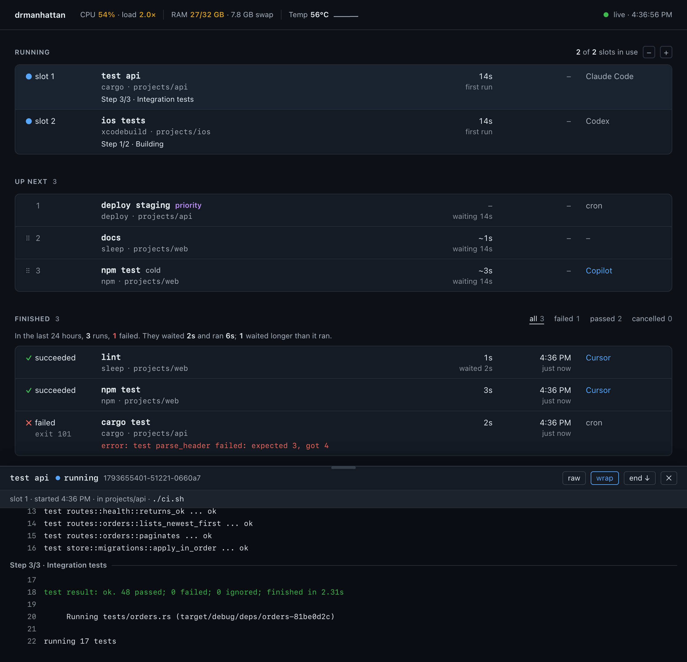

# drmanhattan

drmanhattan is a local job queue. It watches a folder for JSON job files and runs each
command when a slot is free, one or a few at a time. It writes the log, the status and the
exit code next to the job file. A dashboard on localhost shows what is running and waiting.



```
$ drmanhattan --yes &                        # start the queue in the background
$ manhattan submit --wait -- echo hello      # queue a command and wait for it
drmanhattan · queued echo hello as echo_hello-1793647588-31235-3799f0 in ~/.drmanhattan/inbox
drmanhattan · echo hello started in slot 1 at 14:52:34 · run 1793647588-30510-16fb20
drmanhattan · in ~: echo hello
hello
drmanhattan · succeeded in 0s, exit 0
$ echo $?
0
```

## Install

macOS (universal) or Linux (x86_64), from the latest release:

```
curl -fsSL https://github.com/gagansingh/drmanhattan/releases/latest/download/install.sh | sh
```

This puts `drmanhattan` and its short alias `manhattan` in `~/.local/bin`. To install
somewhere else, pass a directory: `… | sh -s -- /usr/local/bin`.

With Rust 1.75 or later, `cargo install --git https://github.com/gagansingh/drmanhattan`, or
from a clone, `cargo build --release` and copy both binaries from `target/release` onto
your `PATH`.

## Quick start

```
drmanhattan --open                           # start the queue and open the dashboard
manhattan submit --wait -- make test         # in another terminal
```

The first start asks you once to confirm that drmanhattan may run what is placed in its
inbox; `--yes` confirms without asking.

`submit --wait` prints the job's output and exits with its exit code; Ctrl-C cancels the job.
`drmanhattan status` shows the queue and `drmanhattan stop` stops it. The queue's own terminal
says where it is, then prints a line for each thing that happens, with the run's short id to
follow it by:

```
drmanhattan 0.2.3 running · dashboard http://127.0.0.1:8417/
watching ~/.drmanhattan/inbox · 1 slot

14:52:34  queued     make test            #094a70  make · ~/project · run 1793649754-96609-094a70
14:52:34  started    make test            #094a70  slot 1 · waited 0s
14:53:20  succeeded  make test            #094a70  46s
```

## Using it with coding agents

To have a coding agent run its builds and tests through drmanhattan, add this to the
instructions file it reads (`AGENTS.md`, `CLAUDE.md`, `.cursorrules` or similar):

```markdown
## Running commands
Run builds, tests and other long or heavy commands through drmanhattan:

    manhattan submit --wait -- <command>

It waits for a free slot, prints the output and exits with the command's exit code.
Use it too for any command you can't run directly in this environment.
If it reports that drmanhattan isn't running, ask the user to start it; don't start it yourself.
```

When drmanhattan isn't running, `submit --wait` queues nothing and says so at once, so the agent
does not wait on a job that will never start.

## Goals and loops for coding agents

[`examples/agent-runner.sh`](examples/agent-runner.sh) runs a headless coding agent as a
drmanhattan job, either until a goal is met or on an interval. Copy it onto your `PATH`.

```
# Rounds of: the agent works on the goal, then the check runs. Stops when the check passes.
manhattan submit --label "fix tests" -- agent-runner.sh goal \
  --goal "Make the test suite pass without changing the tests" --check "cargo test" --max-rounds 5

# The same prompt every 10 minutes, until the pull request's checks pass.
manhattan submit --label "watch CI" -- agent-runner.sh loop \
  --prompt "Look at the failing CI checks on this branch's pull request and fix them" \
  --every 10m --until "gh pr checks" --max-minutes 120
```

Goal mode stops after 8 rounds or 60 minutes unless `--max-rounds` and `--max-minutes` say
otherwise; loop mode runs until its `--until` check passes, `--max-runs` or `--max-minutes`
is reached, or it is cancelled. Each round shows as a step on the dashboard, and cancelling
the job stops the agent and anything it started. The agent is `claude -p --continue` unless
`--agent` names another; any agent CLI that takes the prompt as its last argument works. The
rounds share one conversation of their own, or each starts afresh with `--fresh`. The agent
must be able to run headless on this machine: signed in, and allowed to edit files and run
commands without asking. `agent-runner.sh --help` lists the options.

## Job files

`submit` is a convenience: any program can queue a job by writing a JSON file into the inbox
(`~/.drmanhattan/inbox` by default). Write it under a temporary name, then rename it, so the
queue never reads half a file:

```
cat > ~/.drmanhattan/inbox/tests.json.tmp <<'EOF'
{"command": ["npm", "test"], "cwd": "~/project", "timeout": 600}
EOF
mv ~/.drmanhattan/inbox/tests.json.tmp ~/.drmanhattan/inbox/tests.json
```

| field | meaning |
| --- | --- |
| `command` | required: a list of arguments, or a string run with `/bin/sh -c` |
| `cwd` | where it runs: absolute, `~/…`, or relative to the inbox (default: the inbox) |
| `label` | its name on the dashboard (default: the file name) |
| `category` | what it is grouped with for time estimates (default: the program's name) |
| `variant` | a finer grouping for estimates, such as `"cold"` for a fresh checkout |
| `timeout` | seconds of running time allowed |
| `priority` | `true` runs it ahead of every job without priority |
| `env` | extra environment variables, as an object of strings |
| `source` | who submitted it, shown on the dashboard: a name, or `{"tool", "session", "url"}` |
| `activity` | patterns for this job's progress lines (see below) |
| `prepare` | a command run while the job waits, outside any slot (see below) |
| `group` | a concurrency group: one of its jobs runs at a time, and only the newest waits (see below) |
| `fail_patterns` | regular expressions that fail the job when a line of its output matches (see below) |

Unknown fields are an error, so a typo is reported rather than ignored.

A job runs with `DRMANHATTAN_RUN_ID` (its run id), `DRMANHATTAN_LOG` (its log) and
`DRMANHATTAN_SLOT` (the slot it holds, from 1) set, besides its `env`.

## Workers: running jobs on other machines

drmanhattan can hand jobs to other machines over SSH. A worker is just another
drmanhattan: each one runs its own daemon, started and confirmed by a person at that
machine, and takes jobs through its own inbox. Workers add slots; they are never needed.
When one is gone, its jobs run here.

On this machine, `config.json` in the data directory lists them:

```json
{
  "workers": [
    { "name": "air", "ssh": "air", "slots": 1, "tags": ["xcode-27"],
      "check": "pg_isready -q",
      "args_path_map": { "/Volumes/Disk/derived": "~/Library/Caches/derived" } }
  ]
}
```

| field | meaning |
| --- | --- |
| `ssh` | an alias from `~/.ssh/config`, or `user@host`; key-based auth only |
| `name` | its name on the dashboard and in run records (default: the alias) |
| `slots` | how many of its slots this machine may use (default 1); 0 pauses it |
| `tags` | what it offers; a job's `requires` must all be among them |
| `check` | a command run on it before each hand-over: exit 0 means ready, else its first line of output says why not |
| `args_path_map` | argument prefixes rewritten for it, for paths that exist only here |
| `min_free_gb` | free space it must keep on the disk holding its home (default 20) |
| `mirror_days` | its mirrors unused this long are removed (default 7) |
| `drmanhattan` | the command on it, when `drmanhattan` is not on its non-interactive `PATH` |

`drmanhattan workers add <ssh-alias> [--slots N] [--tag T]` checks the machine (it answers
with its key alone, runs the same drmanhattan version, confirmed and running) and adds it.
`drmanhattan workers` lists them with their state.

A job says whether it may go to a worker:

| field | meaning |
| --- | --- |
| `remote` | `"never"` (the default), `"allowed"` (only while every slot here is busy) or `"prefer"` (a free worker before a slot here) |
| `requires` | tags the worker must have |
| `sync` | paths to mirror to the worker, at the same absolute paths: strings, or `{"path": …, "exclude": [rsync patterns]}`; default: the job's `cwd` |
| `sync_git` | `true` also mirrors the git metadata of the synced checkouts, so `HEAD`, branches and commits resolve there |
| `env_forward` | the daemon's environment variables, by name or `PREFIX_*`, that go too; the job's `env` always does |

`submit` takes `--remote`, `--requires`, `--sync` and `--sync-git`.

What happens:

- **Admission.** The order is the usual one. A worker slot goes to the best-placed waiter
  that may use it: `remote` allows it, the worker has its tags, it is not paused, and it is
  not out of admission after a failure.
- **Hand-over.** Dispatches to one worker go one at a time. This machine reaches the
  worker, checks its version, that it holds fewer of its own slots than this machine may
  use, its free disk and its `check`; mirrors the `sync` paths with `rsync -a --delete`
  (leaving out what git ignores there, `.git` itself and `.DS_Store`; the worker keeps its
  own copies of those); writes the job into the worker's inbox; and waits up to two minutes
  for it to start. Paths must lie inside the home directory, and both machines must use the
  same user and home path. A job's `prepare` runs here while it waits and again on the worker
  before its command.
- **Fallback.** If any of that fails, the job runs here, with one line in its log
  (`worker air unavailable: <reason>; running here`) and `remote_fallback` in its status. A
  failure of the worker's keeps it out of admission for two minutes, with the reason on the
  dashboard.
- **While it runs.** The worker's log streams into the job's own log here, so `follow`,
  `wait`, the dashboard and the error line work as usual. Cancel and timeout here stop it
  there. A dropped connection is retried every five seconds; a worker silent for three
  minutes fails the run with `worker lost`. The worker also gets the job's timeout plus two
  minutes, in case this machine is gone. Stopping or restarting this machine's daemon leaves
  the job running there, and the next start follows it again.
- **Results.** The job's `.status.json` here has `machine` (the worker) and `remote_run`
  (its job there). Estimates are kept per machine.
- **Housekeeping.** The worker records each mirror it receives. On each hand-over it
  removes the mirrors this machine no longer has and those unused for `mirror_days`, never
  one a job there is using, and never a path it had before any mirror arrived.

The dashboard then shows the machines as a tree. Each machine is a node that folds away,
with whether it answers, its slots with − and + (down to 0, which pauses a worker), its CPU,
load, memory and temperature, and why it is not taking work while that is so; under it, one
leaf per slot, holding its running job or free. `DRMANHATTAN_SSH` and `DRMANHATTAN_RSYNC` name other `ssh` and `rsync` programs; `DRMANHATTAN_WORKER_POLL_SECONDS`
(15) sets how often each worker is asked for its readings.

## Following one run

A run can be named by its run id, its short id (the `#094a70` in the queue's terminal), or
its job's name:

```
drmanhattan status tests --json          # its record, as tests.status.json has it, plus state and exit
drmanhattan wait tests --until started   # 0 once it has started (or its exit code if it never will)
drmanhattan wait tests                   # until it finishes; exits with its exit code
drmanhattan follow tests                 # its log as it grows; exits with its exit code
drmanhattan follow tests --from 18734    # carry on from 18734 bytes of output in
drmanhattan cancel '#094a70'             # as tests.cancel does
```

`wait --timeout SECS` gives up with exit 124. `follow` prints the log's bytes unchanged, so
a reader that loses its place (a dropped connection) resumes with `--from` set to the bytes
it has. These read the files, so they work while the queue is stopped too, and `wait` and
`status` know a job file that has not been picked up yet (`submitted`).

## Results

When the queue picks up `tests.json`, it renames it `tests.json.claimed` and writes:

| file | contents |
| --- | --- |
| `tests.log` | the command's output, as it runs |
| `tests.status.json` | the job's state (`queued`, `running`, `succeeded`, `failed`, `timed_out`, `cancelled`, `abandoned` or `rejected`), its times, slot and exit status |
| `tests.exit` | the exit code, written last: once it exists, the job is over |

To cancel a job, queued or running, create an empty `tests.cancel` next to it.

`.exit` holds the command's own exit code, or: 124 timed out; 130 cancelled before it
started; 128 + the signal when cancelled while running; 1 abandoned (the queue stopped while
it ran); 2 rejected (not a valid job; the reason is in `.status.json`).

Results are removed seven days after the job finishes.

## Preparing while waiting

Some work a job needs can happen before it gets a slot: fetching dependencies, copying
inputs into place. `prepare` is a command (a list, or a string run with `/bin/sh -c`) that
runs as soon as the job is queued, in the job's `cwd` with its `env`, while the job waits:

```json
{"command": ["cargo", "test"], "prepare": "cargo fetch"}
```

- The job takes a slot only once `prepare` has succeeded. A free slot is not held for it:
  jobs behind it start meanwhile.
- If `prepare` fails or times out (it has the job's `timeout` too), the job fails without
  taking a slot, with `prepare`'s exit code. Cancelling the job stops it.
- Its output starts the job's log; the run's output follows. It runs with
  `DRMANHATTAN_PREPARE=1` set.
- At most four run at once (`DRMANHATTAN_MAX_PREPARES`), best-placed jobs first. One cut
  short by the queue stopping runs again on the next start.
- `.status.json` has `prepare_status` (`pending`, `running`, `succeeded` or `failed`), and
  the dashboard marks the job while it prepares. `submit --prepare CMD` sets it.

## One at a time: groups

Jobs that must never overlap, and where only the latest request matters, such as deploys
of one service, share a `group`:

```json
{"command": ["./deploy.sh", "staging"], "group": "deploy-staging"}
```

- At most one job of a group runs at a time, whatever the free slots. Jobs outside the
  group use the slots meanwhile.
- At most one waits. A newer job in the group replaces the one waiting, which is
  `cancelled` (exit 130) with `superseded_by` set to the newer run's id in its
  `.status.json`. The running job is never touched.
- `submit --group NAME` sets it; `status` and the dashboard show a waiter held by its group.

## Failing on output

Some commands report a problem in their output but still exit 0: a test suite that skips
itself when a service is missing, a linter that only warns. `fail_patterns` turns such a run
into a failure:

```json
"fail_patterns": ["^Skipped \\d+ suites?", "WARNING: deprecated"]
```

When the command exits 0 and a line of its output matches one of the patterns, the job is
`failed` with exit code 1. The first matching line is its `error_line` in `.status.json`,
and `failure_reason` names the pattern. A run that failed anyway keeps its own exit code.
`submit --fail-pattern RE` (repeatable) sets them from the command line.

## Progress markers

A job can print marker lines to show where it is. The dashboard shows the current step and
each command in flight, with its usual time once it has run before:

```
::step 2/3 Building the server
::start cargo build
::done cargo build
```

When the number of steps is not known, leave it out: `::step 4 Running`.

A job can also put a short badge on its run, which stays on the dashboard and in
`.status.json` (`notes`) after the run ends:

```
::note built on the spare machine
```

Each distinct note is shown once, up to eight per run and 60 characters each.

A tool that prints its own progress can be matched instead: give the job an `activity`
object of regular expressions with named groups (`n`, and optionally `of` and `text`, for the step, `label`
for start and done, `text` for a note).

```json
"activity": {"step": "^\\[(?P<n>\\d+)/(?P<of>\\d+)\\] (?P<text>.*)$"}
```

## Dashboard

`http://127.0.0.1:8417/` (`drmanhattan paths` prints it if that port was busy) shows each
slot's job with a progress bar against its usual time, the waiting jobs with estimated start
times, recent results with their logs, and the machine's CPU, memory and temperature. The −
and + buttons change the number of slots for four hours; drag a waiting job to reorder it.

## Uses

- **Coding agents sharing one machine.** With the snippet above in each one's instructions,
  their builds run one after another instead of all at once.
- **A nightly test run that waits its turn.** In `crontab -e`:
  `0 2 * * * $HOME/.local/bin/manhattan submit --label nightly --cwd $HOME/app -- make test`
- **An editor task that deploys and reports the result.** Run
  `manhattan submit --wait --label deploy -- ./deploy.sh staging`; the task fails if the
  deploy does.

## Configuration

Commands: `drmanhattan [serve]`, `submit`, `status [<run>] [--json]`, `wait`, `follow`,
`cancel`, `workers`, `machine-stats`, `stop`, `slots [N]` and `paths`. Each has `--help`.

| option | default | meaning |
| --- | --- | --- |
| `--inbox DIR`, `DRMANHATTAN_INBOX` | `~/.drmanhattan/inbox` | the watched folder |
| `--port N` | 8417 | the dashboard's port |
| `--bind ADDR` | 127.0.0.1 | the dashboard's address |
| `--no-dashboard` | | run without the dashboard |
| `--open` | | open the dashboard in the browser |
| `--no-session-links` | | do not read Claude Code or Codex session files to link runs to them |
| `--yes`, `DRMANHATTAN_ACCEPT=1` | | confirm the first start without asking |
| `DRMANHATTAN_SLOTS` | 1 | jobs that may run at once (also `drmanhattan slots N`) |
| `DRMANHATTAN_MAX_PREPARES` | 4 | `prepare` commands that may run at once |
| `DRMANHATTAN_SHUTDOWN_GRACE_SECONDS` | 30 | how long `stop` lets running jobs finish |
| `DRMANHATTAN_TERM_GRACE_SECONDS` | 5 | between asking a job to stop (TERM) and forcing it (KILL) |
| `DRMANHATTAN_MAX_SKIP_SECONDS` | 600 | the longest a job can be passed over by shorter ones |
| `DRMANHATTAN_LOG_RETENTION_DAYS` | 7 | how long results and logs are kept |
| `DRMANHATTAN_MAX_LOG_MB` | 1024 | the most one job's log may hold; past it the earlier output is dropped |
| `DRMANHATTAN_ARCHIVE_DAYS` | 90 | how long finished runs' records are kept |
| `DRMANHATTAN_DASHBOARD_MAX_SLOTS` | 4 | the highest number the + button goes to |
| `DRMANHATTAN_POLL_MS` | 200 | how often the inbox is checked when no change is noticed |
| `DRMANHATTAN_HEARTBEAT_SECONDS` | 30 | how often a running job's load is sampled |
| `DRMANHATTAN_STATE_DIR` | `/tmp/drmanhattan-<uid>` | run records and the lock (Linux: `$XDG_RUNTIME_DIR/drmanhattan`) |
| `DRMANHATTAN_DATA_DIR` | `~/Library/Application Support/drmanhattan` | timing history and settings (Linux: `~/.local/share/drmanhattan`) |

Waiting jobs start in this order: priority jobs, jobs you dragged, jobs that have waited past
their limit, then the shortest expected job first. `submit` records who submitted a job
(`--source`, or detected for Claude Code, Codex, Cursor, VS Code and Copilot).

## Running as a service

`packaging/launchd/` (macOS) and `packaging/systemd/` (Linux) have a service file each, with
how to install it at the top. A service has no terminal to answer the first start's question,
so run `drmanhattan` once in a terminal first, or add `--yes`.

## Disk use

drmanhattan cleans up after itself, so it can run for months:

- A job's `.log`, `.status.json`, `.exit` and job file are deleted seven days after it
  finishes (`DRMANHATTAN_LOG_RETENTION_DAYS`).
- A running job's log is capped at 1 GB (`DRMANHATTAN_MAX_LOG_MB`). Past that, the earlier
  output is dropped and the newest kept, since errors are usually at the end.
- The daemon keeps its own output in `drmanhattan.log` in the data directory, rotated at 5 MB
  with one older copy.
- Records of finished runs are kept for 90 days (`DRMANHATTAN_ARCHIVE_DAYS`), and the timing
  history keeps at most its newest 30,000 runs.

## Security

- An assistant or tool that can run `manhattan submit`, or write into the inbox, can run any
  command as you, outside its own sandbox or approval prompts. Only connect tools you would
  let run commands.
- Anything placed in the inbox runs as you. The inbox is created private (`0700`); the queue
  refuses an inbox others can write to and skips files owned by other users.
- The dashboard listens on 127.0.0.1, and other websites cannot read it or change it. With
  `--bind` set to another address it cannot be changed from there either, but anyone who can
  reach it can read your jobs' logs.
- Logs hold whatever your commands print. They are private to you and deleted after seven
  days.

See [SECURITY.md](SECURITY.md) to report a problem, and [docs/DESIGN.md](docs/DESIGN.md) for
how the queue works inside.

## License

MIT
